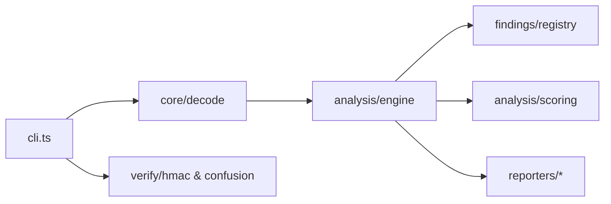

# hx-jwt-audit-cli — architecture

## Purpose

Decodes JWT/JWS tokens, evaluates header and claim policies through pluggable findings,
produces scored reports, and runs optional cryptographic verification probes (HMAC, weak
secret list, algorithm confusion). Non-goals: online brute force at scale or forging
tokens for unauthorized systems.

## High-level flow

## Module map

| Path                               | Responsibility                                                  |
| ---------------------------------- | --------------------------------------------------------------- |
| `src/cli.ts`                       | `audit`, `batch`, `verify-hmac`, `crack-weak`, `confusion-test` |
| `src/index.ts`                     | Library exports                                                 |
| `src/core/decode.ts`               | Token/file decode and batch ingest                              |
| `src/core/segments.ts`             | Base64url segment parsing                                       |
| `src/analysis/engine.ts`           | Run finding registry, build report                              |
| `src/analysis/context.ts`          | Shared analysis context                                         |
| `src/analysis/scoring.ts`          | Risk score from findings                                        |
| `src/findings/registry.ts`         | Ordered list of finding modules                                 |
| `src/findings/*.ts`                | Individual rules (alg-none, jku, x5u, exp, aud, etc.)           |
| `src/findings/types.ts`            | Finding interface                                               |
| `src/types/`                       | JWT, report, and finding type definitions                       |
| `src/utils/b64url.ts`              | Base64url helpers                                               |
| `src/utils/pem.ts`                 | PEM file loading                                                |
| `src/utils/time.ts`                | Claim time comparisons                                          |
| `src/verify/hmac.ts`               | HMAC signature verification                                     |
| `src/verify/wordlist.ts`           | Weak secret list loader and crack loop                          |
| `src/verify/confusion/rs-to-hs.ts` | RS→HS confusion probe                                           |
| `src/reporters/json.ts`            | JSON report                                                     |
| `src/reporters/markdown.ts`        | Markdown report                                                 |
| `src/reporters/sarif.ts`           | SARIF 2.1 output                                                |
| `src/reporters/table.ts`           | Terminal table                                                  |

## Extension

1. Add `src/findings/your-rule.ts` implementing the finding interface.
2. Register it in `findings/registry.ts`.
3. Add unit tests with fixture tokens — no live `jose` network calls in unit tests.
4. Run `npm test` and `npm run format:check`.

## Testing strategy

- **Unit**: decode, each finding module, scoring, reporters, verify helpers.
- **Integration**: `jest.integration.config.js` — optional JWKS fetch scenarios.

## Ethics & scope

Authorized engagements only. See [SECURITY.md](./SECURITY.md).
